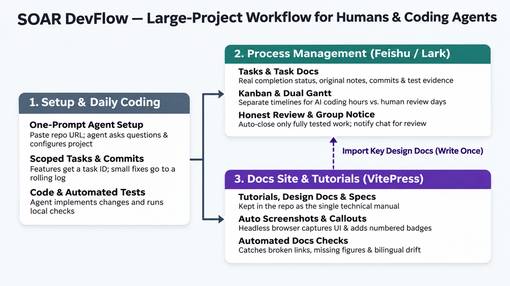

<p align="center">
  
</p>

<h1 align="center">SOAR DevFlow</h1>
<h3 align="center">Process Management &amp; Technical Documentation Workflow for Large Projects</h3>

<p align="center">
  <a href="https://www.soar-lab.org/">
    
  </a>
</p>

<p align="center">
  <a href="LICENSE"></a>
  <a href="https://soar-lab.org/soar-devflow/en/"></a>
  <a href="skills/"></a>
  <a href="https://github.com/NJU-SOARLAB/soar-devflow/actions/workflows/ci.yml"></a>
</p>

<p align="center">
  <a href="README.md">中文</a> &nbsp;·&nbsp;
  <a href="https://soar-lab.org/soar-devflow/en/">Website</a> &nbsp;·&nbsp;
  <a href="https://soar-lab.org/soar-devflow/en/guide/live-demo.html">Live Board Demo</a> &nbsp;·&nbsp;
  <a href="#for-ai-coding-agents">Setup Instructions for Coding Agents</a>
</p>

---

Coding agents are great for quick prototypes, but large multi-week repositories with dozens of modules and multiple contributors usually run into three practical headaches:

1. **"Done" stops meaning done.** An agent writes code, runs one happy-path script, and claims the task is finished—long before edge cases or hardware tests are checked. Meanwhile, scattering `PLAN_x.md` and `NOTES_y.md` files into the repo turns the tree into a graveyard within two weeks.
2. **Schedules stop making sense.** An agent may finish coding in two hours, while human code review, lab bench access, or integration testing takes three days. Putting both on a single timeline makes Gantt charts useless.
3. **Tutorials rot immediately.** Temporary task notes pile up, yet new teammates still cannot find a clean step-by-step guide, and manual UI screenshots go stale after the next frontend tweak.

**SOAR DevFlow** grew out of vibe coding complex robotics systems at **SOARLAB (Nanjing University)**. It packages our day-to-day workflow into three reusable **Agent Skills** plus straightforward Python/Node scripts:

<p align="center">
  
</p>

- **Process tracking in Feishu / Lark (`soar-devflow-tasks`)**: Real features get a native task and one dedicated task doc (recording original user requests, commit hashes, test outputs, and remaining human checks); tiny fixes append to a single rolling log. A sync script mirrors tasks into a Base table, embeds an interactive HTML5 Kanban + **dual-timeline Gantt** (AI coding hours vs. human review days) right inside the project overview doc, and lets agents post non-duplicate delivery summaries to group chat.
- **Technical docs & tutorials in Git (`soar-devflow-docs`)**: Keep sprint logs out of the codebase; use `docs/site/` (VitePress) strictly for durable **tutorials**, **design references**, and **specs**. Ships with practical writing templates, a script that opens your app in a headless browser to take **auto-annotated UI screenshots**, and a pre-commit check script that catches broken links, missing images, and bilingual drift. Key design docs can also be imported straight into Feishu from the same Markdown file so nobody writes them twice.

> You can use both modules together, or enable either Process Management or Docs Site standalone.

---

## Quickest Way to Start

Paste the following prompt directly into **Claude Code, Codex, Antigravity, or Cursor** inside your project. Your agent will read the setup instructions at the bottom of this file, ask a few quick questions, and set everything up for you:

```text
Please read https://github.com/NJU-SOARLAB/soar-devflow/blob/main/README.en.md
(including the Setup Instructions for Coding Agents at the bottom), ask me about my
project preferences, and install, configure, and verify SOAR DevFlow in this repository.
```

Want to try the interactive Kanban + dual-timeline Gantt board in your browser first? Visit the website:
👉 **[https://soar-lab.org/soar-devflow/en/](https://soar-lab.org/soar-devflow/en/)**

### What's Inside

- **`skills/soar-devflow-setup`**: Interactive onboarding, one-command Feishu tasklist / Base / views / overview page creator (with `--dry-run`), and VitePress site generator.
- **`skills/soar-devflow-tasks`**: Task workflow rules, native-task-to-Base sync, embedded HTML5 board/Gantt renderer, completed-section auto-folding, group chat delivery notifier, and Markdown-to-Feishu XML converter.
- **`skills/soar-devflow-docs`**: Tutorial & reference writing templates, headless browser screenshot & numbered-badge tool, and automated docs checker.

Your project's own board IDs and docs settings live in `.soar-devflow/` inside your repository (no credentials—authentication stays in `lark-cli` on your machine).

---

<a id="for-ai-coding-agents"></a>
<!-- AGENT_BOOTSTRAP_START -->

## For AI Coding Agents: Setup Instructions

When a user gives you this repository link and asks you to set up **SOAR DevFlow**:

1. **Clone to a local cache**: Clone `https://github.com/NJU-SOARLAB/soar-devflow` into `~/.cache/soar-devflow` (do not nest inside the user's tracked Git repo). Read `skills/soar-devflow-setup/SKILL.md`.
2. **Check the environment first**: Inspect `git status`, `AGENTS.md`/`CLAUDE.md`, `docs/site/`, `.soar-devflow/`, and tool versions (`python3 >= 3.10`, `node >= 18`, and `lark-cli` if using Feishu/Lark). Never read, print, or commit credentials.
3. **Ask concise setup questions (1–2 turns max)**:
   - Which modules to enable: `Both` (recommended), `Process-only`, or `Docs-only`
   - Project name, task ID prefix (e.g. `CORE`, `BOT`), skill install location (`workspace` vs `global`)
   - If Process enabled: `lark-cli` profile, create new Feishu boards automatically vs. use existing IDs, domain sections, project stages, optional Wiki `space_id`/`parent_node_token`, optional group `chat_id` (`oc_...`)
   - If Docs enabled: languages (`zh`, `en`, or `zh,en`), VitePress `base` path, optional dev server URL for automated screenshots
4. **Install skills & initialize**:
   - Run `install_skills.py --target <repo> --scope workspace --mode copy`.
   - For Feishu: run `init_feishu_project.py --spec /tmp/soar-devflow-init.json --dry-run` first, show the planned resources to the user for approval, then run without `--dry-run`. If initial sync returns `next_run_updates_links: true`, wait a few seconds and run `sync_tasks.py --allow-create-overview --seed-process-fields` once more.
   - For Docs: run `init_docs_site.py --target <repo> --title "<Title>" --languages <langs> --base <base>`.
   - Append `templates/AGENTS.snippet.md` to `AGENTS.md` without overwriting existing project rules.
5. **Verify & report**: Run `sync_tasks.py --dry-run` (if enabled), `check_docs.py --check`, and `npm install && npm run build` in the docs folder. Report created files, Feishu URLs, and test results honestly.

<!-- AGENT_BOOTSTRAP_END -->

---

## License

[MIT](LICENSE) © 2026 SOARLAB, Nanjing University
