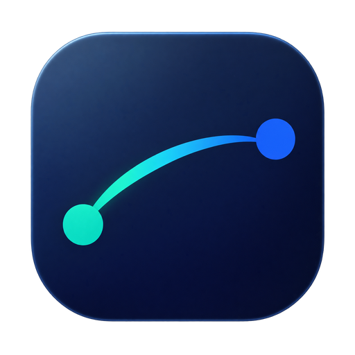
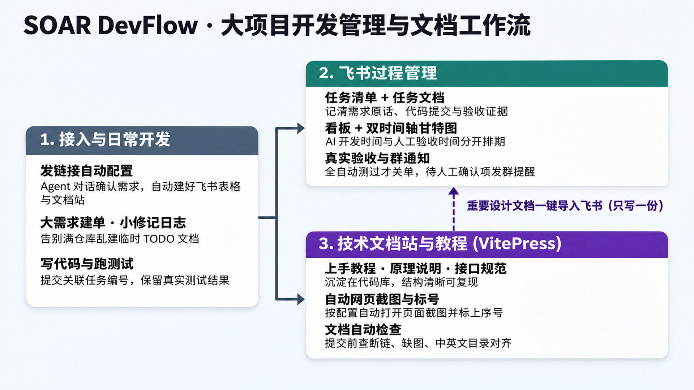

<p align="center">
  
</p>

<h1 align="center">SOAR DevFlow</h1>
<h3 align="center">面向大项目开发的进度管理与技术文档工作流</h3>

<p align="center">
  <a href="https://www.soar-lab.org/">
    
  </a>
</p>

<p align="center">
  <a href="LICENSE"></a>
  <a href="https://soar-lab.org/soar-devflow/"></a>
  <a href="skills/"></a>
  <a href="https://github.com/NJU-SOARLAB/soar-devflow/actions/workflows/ci.yml"></a>
</p>

<p align="center">
  <a href="README.en.md">English</a> &nbsp;·&nbsp;
  <a href="https://soar-lab.org/soar-devflow/">文档网站</a> &nbsp;·&nbsp;
  <a href="https://soar-lab.org/soar-devflow/guide/live-demo.html">在线看板演示</a> &nbsp;·&nbsp;
  <a href="#for-ai-coding-agents">给 Agent 的自动配置说明</a>
</p>

---

用 Coding Agent 写小工具很快，但一旦项目变大——几十个模块、多人多 Agent 同时改、一干好几周——往往会遇到三个头疼问题：

1. **真假完成分不清**：Agent 改完代码跑通一个小例子就敢报“已完成”，其实离真正能用还差很远；每接一个任务往代码库塞一篇 `PLAN.md`、`SUMMARY.md`，过两周连自己都分不清哪篇是最新的。
2. **排期算不到一块去**：AI 写代码只要一两个小时，但人去审方案、上真机验证、等外部联调可能要排两三天，混在一张表里根本没法看进度。
3. **教程没人好好写**：仓库里堆满过期的过程记录，新人进来却找不到一篇能照着跑通的教程；好不容易截了几张界面图，UI 改一版就全废了。

**SOAR DevFlow** 是南京大学 SOARLAB 在做机器人复杂系统 Vibe 开发时磨出来的一套工作流，把**过程管理**和**技术文档**两件事串在了一起：

<p align="center">
  
</p>

- **过程留在飞书，清清楚楚**：大需求建飞书任务，日常小修统一记一条滚动日志。每个任务配一篇文档，记清楚需求原话、改了哪个 commit、测了什么、还差什么人工确认。脚本会自动同步到多维表格，并在汇总页嵌入交互式看板和**双时间轴甘特图**（把「AI 开发时间」和「人工验收时间」分开看）；做完还能往群里发一条交付通知。
- **文档留在代码库，好看耐读**：过程流水不塞进代码库，代码库里的 `docs/site/`（VitePress）只维护真正沉淀下来的**上手教程**、**原理说明**和**接口规范**。配好了现成的写作模板、自动打开网页截图打标号的工具，以及提交前的自动检查脚本（防断链、防缺图、防中英文章节对不上）。重要的架构文档还能从同一份 Markdown 直接导入飞书，不用写两遍。

> 飞书过程管理和 VitePress 文档站两个模块可以一起用，也可以只开其中一个。

---

## 怎么开始用？

最省事的办法：不用自己翻配置文档，直接把下面这句话发给你的 **Claude Code / Codex / Antigravity / Cursor**。它会读本文档后半段的安装说明，问你几个问题，然后自动把整套流程配好：

```text
请阅读 https://github.com/NJU-SOARLAB/soar-devflow 的 README（包含底部的 Agent 配置说明），
先问清楚我的项目设置偏好，然后在当前仓库帮我装好并验证 SOAR DevFlow。
```

想先看看做出来的看板、双时间轴甘特图和完整文档长什么样，直接打开配套网站：
👉 **[https://soar-lab.org/soar-devflow/](https://soar-lab.org/soar-devflow/)**

### 仓库里有什么？

- **`skills/soar-devflow-setup`**：交互式安装引导，包含一键在飞书建好任务清单 / 多维表格 / 看板甘特视图 / 汇总页的脚本，以及一键生成 VitePress 文档站的脚本。
- **`skills/soar-devflow-tasks`**：飞书过程管理规范，包含任务同步、汇总页 HTML5 看板与甘特图生成、已完成分区自动折叠、群交付通知（防重复发送）和 Markdown 导入飞书脚本。
- **`skills/soar-devflow-docs`**：文档站与教程写作规范，包含教程/原理说明写作模板、自动网页截图与编号标注工具、以及文档自动检查脚本。

安装后，你项目自己的飞书链接、表格 ID 和文档站设置都保存在你仓库的 `.soar-devflow/` 目录里（不含账号密码，账号登录由官方 `lark-cli` 在本机管理），不同项目互不干扰。

### 本地跑测试与构建网站

```bash
python3 -m unittest discover -s tests -v
python3 scripts/privacy_scan.py
python3 skills/soar-devflow-docs/scripts/check_docs.py --config site/docs.config.json --check
cd site && npm ci && npm run build
```

---

<a id="for-ai-coding-agents"></a>
<!-- AGENT_BOOTSTRAP_START -->

## For AI Coding Agents: Setup Instructions

> **给 Coding Agent（Claude Code、Codex、Antigravity、Cursor 等）的执行说明：**
> 当用户把本仓库链接发给你，让你在当前项目接入 **SOAR DevFlow** 时，请按下面 5 步执行。不要把下面整段说明复述给用户——先自己检查环境，把需要确认的问题一次性问清楚，创建远端飞书资源前先跑 `--dry-run` 给用户看一眼，最后跑通验证再汇报。

### 第 0 步：拉取本仓库到本地缓存

将 `https://github.com/NJU-SOARLAB/soar-devflow` 克隆到临时或缓存目录（如 `~/.cache/soar-devflow`），不要直接克隆进用户业务仓库的 Git 跟踪目录里。然后阅读 `skills/soar-devflow-setup/SKILL.md` 与 `skills/soar-devflow-setup/references/interview-questions.md`。

### 第 1 步：静默检查当前环境

提问前先自己在目标仓库里查清楚：
1. 当前目录是不是 Git 仓库，是否已有 `AGENTS.md` / `CLAUDE.md`、`docs/site/` 或 `.soar-devflow/`；
2. 本地环境版本：
   - `python3 --version`（需 >= 3.10）
   - `node -v && npm -v`（启用文档站或网页截图时需 >= 18）
   - `which lark-cli && lark-cli --version`（启用飞书过程管理时需要）
3. **不要读取、打印或提交任何凭据/Token**。如果用户要用飞书模块但还没装 `lark-cli`，提示对方先运行 `npx @larksuite/cli@latest install` 并完成登录。

### 第 2 步：向用户确认项目设置（1～2 轮问完）

只问还没确定的项：
1. **启用哪些模块**：`全部启用`（推荐：飞书过程管理 + VitePress 文档站）、`只用飞书过程管理`、还是 `只用文档站与教程工作流`？
2. **项目基本信息**：项目名称、任务编号前缀（比如 `CORE`、`BOT`）、Skill 安装在当前仓库（`workspace`，写入 `.agents/skills/` 并软链 `.claude/skills/`）还是本机全局（`global`，写入 `~/.agents/skills/`）？
3. **如果启用飞书过程管理**：
   - 用哪个 `lark-cli` profile（留空用默认 profile）？
   - 让脚本自动新建一套飞书清单/多维表格/汇总页，还是绑定已有资源 ID？
   - 任务分组（默认：`架构与内核`、`核心业务`、`接口与工具`、`验证与发布`）和项目阶段（默认：`阶段一·基线与架构`、`阶段二·核心能力`、`阶段三·集成与验收`、`日常·滚动维护`）要不要改？
   - 可选：要放进哪个飞书知识库（`space_id` / `parent_node_token`，留空则建在个人云盘）？要不要配交付通知群 `chat_id`（`oc_...`）？
4. **如果启用文档站**：
   - 单语言（如只写中文 `zh`）还是中英双语（`zh,en`）？
   - 网站路径前缀 `base`（默认 `/docs/`，GitHub Pages 项目站常用 `/<仓库名>/`）？
   - 要不要配自动网页截图的目标开发地址（如 `http://127.0.0.1:5173`）？

### 第 3 步：安装 Skills

```bash
python3 <soar-devflow-repo>/skills/soar-devflow-setup/scripts/install_skills.py \
  --target <target-repo-root> \
  --scope workspace \
  --mode copy
```

（若用户选全局安装，把 `--scope workspace` 改成 `--scope global`。）

### 第 4 步：执行初始化（远端操作必须先 `--dry-run`）

1. **飞书过程管理（若启用）**：
   先把参数写成临时 JSON（如 `/tmp/soar-devflow-init.json`），先跑 `--dry-run`：
   ```bash
   python3 <installed-skills>/soar-devflow-setup/scripts/init_feishu_project.py \
     --spec /tmp/soar-devflow-init.json --dry-run
   ```
   把准备创建的任务清单、表格、视图和汇总页给用户确认后，去掉 `--dry-run` 正式执行。脚本会自动建好远端资源并生成 `.soar-devflow/tasks.json`、`task_documents.json` 和可选的 `notifications.json`。
   - 如果首次同步返回 `next_run_updates_links: true`（多维表格新行刚建好时的正常缓冲），等几秒再跑一次 `sync_tasks.py --allow-create-overview --seed-process-fields` 即可。
2. **VitePress 文档站（若启用）**：
   ```bash
   python3 <installed-skills>/soar-devflow-setup/scripts/init_docs_site.py \
     --target <target-repo-root> \
     --title "<项目名称>" \
     --description "<项目简介>" \
     --languages zh,en \
     --base /docs/
   ```
3. **写入 `AGENTS.md` 入口**：
   把 `templates/AGENTS.snippet.md` 的内容追加到目标仓库的 `AGENTS.md` 末尾（没有则新建，已有则保留原内容只追加）。

### 第 5 步：验证并汇报结果

```bash
# 若启用了飞书过程管理：
python3 <installed-skills>/soar-devflow-tasks/scripts/sync_tasks.py --dry-run

# 若启用了文档站：
python3 <installed-skills>/soar-devflow-docs/scripts/check_docs.py --check
cd <target-repo-root>/docs/site && npm install && npm run build
```

向用户交代清楚：本地生成了哪些文件、飞书清单/表格/汇总页的实际链接、哪些验证已跑通（没跑的如实说明），以及下一步怎么建第一个任务或写第一篇教程。

<!-- AGENT_BOOTSTRAP_END -->

---

## License

[MIT](LICENSE) © 2026 SOARLAB, Nanjing University
