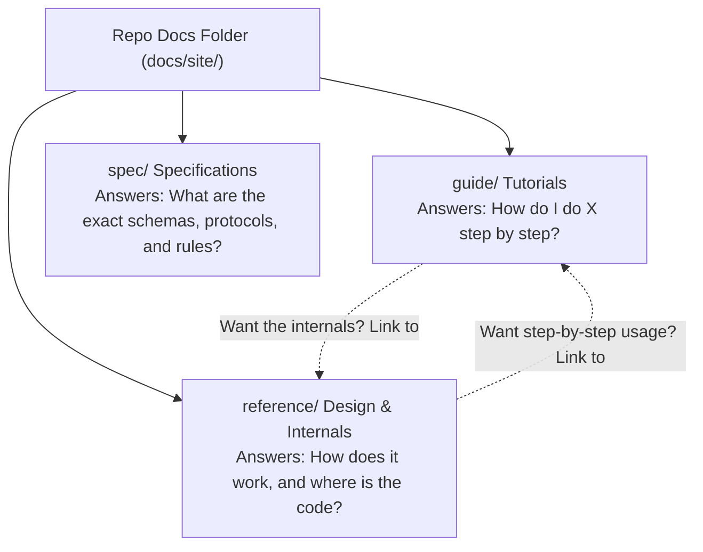

# Docs Site & Tutorials

Left to their own devices, coding agents often write fluffy documentation: beginners cannot tell what to click first, maintainers cannot tell which file implements a formula, and manual screenshots go out of date after two UI commits. `soar-devflow-docs` pairs clear writing templates with automated UI screenshots and pre-commit checks.

## Split Docs by What the Reader Needs {#taxonomy}

All technical docs live in `docs/site/` (powered by VitePress), separated into three clear categories instead of mixing tutorials and internals together:



| Category | Reader | How to Write It |
| --- | --- | --- |
| **Tutorials `guide/`** | First-time users, operators, new teammates | Numbered task steps; every step states what to run or click and **what result you should see**, paired with numbered UI screenshots |
| **Design Docs `reference/`** | Engineers debugging, reviewing logic, or extending modules | Scope & non-goals up front, equations, Mermaid diagrams, parameter tables with config paths, source file locations, and how to verify |
| **Specs `spec/`** | Cross-module or cross-team integrators | Exact field definitions, state transitions, error codes, and explicit `{#id}` heading anchors for stable links |

## Practical Templates & Fact-Checking Rules {#templates}

Ready-to-use templates live under `skills/soar-devflow-docs/references/`:

- **7-Part Tutorial Structure**: One-paragraph intro → What you will learn → Prerequisites → UI overview (annotated screenshot + numbered legend) → Step-by-step instructions (with expected output) → Advanced tips → Troubleshooting table → Links to design docs.
- **8-Part Reference Structure**: Goals & non-goals → Models & equations → Dataflow / state diagrams → Parameter table (with source file paths) → Code locations → How to reproduce & verify → Known limits & common misreadings → Audit notes (any mismatch between old docs and current code noted plainly).

Three ground rules keep agent-written docs honest:
1. **Check the code first**: Verify every default value, CLI flag, and file path against current source files instead of guessing from memory;
2. **State limits plainly**: If something is approximate or untested, say so—never describe "wired up" as "verified";
3. **Leave sprint logs out**: Meeting notes and scope changes belong in Feishu task docs; technical pages describe how the system works today.

## Automated Web Screenshots with Numbered Callouts {#screenshots}

Re-taking twenty screenshots by hand after a UI tweak is painful. `capture_shots.mjs` lets you declare what to capture in JSON so Playwright opens your app, highlights target elements, and draws ①②③ badges automatically:

1. Declare the route, viewport, theme, and callout selectors in `docs/site/shots/<page>.json`:
   ```json
   [
     {
       "id": "dashboard-overview",
       "page": "/dashboard",
       "viewport": [1440, 900],
       "theme": "dark",
       "annotate": [
         { "selector": "#run-btn", "label": "1" },
         { "selector": "#status-bar", "label": "2", "badge": "left" }
       ]
     }
   ]
   ```
2. Capture or refresh images in one command (saved to `public/shots/<id>.png`):
   ```bash
   node .agents/skills/soar-devflow-docs/scripts/capture_shots.mjs \
     --upstream http://127.0.0.1:5173 --only dashboard-overview
   ```
3. **Safe against live dev servers**: A local proxy forwards `GET`/`HEAD` requests while blocking every `POST`/`PUT`/`DELETE` request locally, so taking screenshots against a running app cannot accidentally trigger actions or mutate state. Callout badges also attach cleanly above open `<dialog>` modals.

## Automated Pre-Commit Docs Checks (`check_docs.py`) {#gates}

Run `check_docs.py --check` before committing or in CI to catch common doc mistakes automatically:

- **Unclosed angle brackets**: VitePress compiles Markdown as Vue templates, so bare placeholders like `<stage>` in prose crash the build—the script catches them early;
- **Broken links & missing images**: Verifies every internal link, `#anchor`, and `/public/...` image actually exists;
- **Bilingual alignment** (when multiple languages are enabled): Confirms paired pages have matching `sourceRevision` numbers and identical `{#anchor}` headings, and blocks `@include` shortcuts;
- **Empty stubs**: Rejects tutorial or reference pages that fall below minimum length or have zero screenshots/diagrams;
- **Stray Markdown files**: Prevents scattering duplicate technical docs outside `docs/site/` or copy-pasting `README.md` paragraphs verbatim into site pages.

## Further Reading

- Full `.soar-devflow/docs.json` options: [Configuration Reference](../reference/config-schema.md#docs-json)
- Importing key design docs from Markdown into Feishu: [Process Management](./task-workflow.md#truth-sources)
