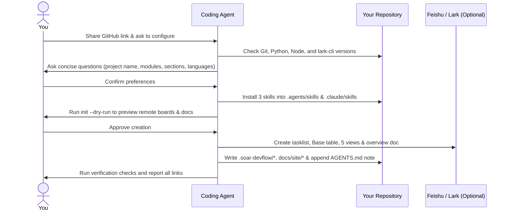

# Quickstart

There are two ways to set up **SOAR DevFlow** in your repository: the easiest way is to paste the GitHub link to your coding agent and let it ask a few setup questions; or you can run four commands yourself. Process Management (Feishu/Lark) and the Docs Site (VitePress) are independent—use both together or pick just one.

## Option 1: Let Your Coding Agent Set It Up {#agent-setup}

Open **Claude Code, Codex, Antigravity, or Cursor** in your project folder and send:

```text
Please read https://github.com/NJU-SOARLAB/soar-devflow/blob/main/README.en.md
(including the Setup Instructions for Coding Agents at the bottom), ask me about my
project preferences, and install, configure, and verify SOAR DevFlow in this repository.
```

Your agent will walk through these steps:



Before creating anything in your Feishu/Lark workspace, the agent runs `--dry-run` first so you can review the planned boards and documents. Existing rules in your `AGENTS.md` are left untouched.

## Option 2: Manual CLI Setup {#manual-setup}

If you prefer running each step directly from your terminal:

1. **Clone into a cache directory and install the skills**:
   ```bash
   git clone https://github.com/NJU-SOARLAB/soar-devflow.git ~/.cache/soar-devflow
   python3 ~/.cache/soar-devflow/skills/soar-devflow-setup/scripts/install_skills.py \
     --target /path/to/your-repo \
     --scope workspace \
     --mode copy
   ```
   - Use `--scope global` if you want the skills installed once under `~/.agents/skills/` for every repo on your machine.
   - This creates `.agents/skills/soar-devflow-{setup,tasks,docs}` plus `.claude/skills/` symlinks.

2. **Initialize Feishu / Lark Process Management (Optional — preview with `--dry-run` first)**:
   Make sure the official `lark-cli` (`npx @larksuite/cli@latest install`) is installed and logged in, then run:
   ```bash
   python3 .agents/skills/soar-devflow-setup/scripts/init_feishu_project.py \
     --project "Nova Stack" \
     --prefix NOV \
     --sections "架构与内核,核心算法,接口与工具,验证与发布" \
     --stages "阶段一·架构基线,阶段二·核心功能,阶段三·集成验收,日常·滚动维护" \
     --dry-run
   ```
   Once the preview looks right, re-run without `--dry-run` (add `--space-id`, `--parent-node-token`, or `--chat-id` if placing docs in a Wiki space or enabling group chat notices). The script writes `.soar-devflow/tasks.json`, `task_documents.json`, and optional `notifications.json`.

3. **Initialize the VitePress Docs Site (Optional & Independent of Feishu)**:
   ```bash
   python3 .agents/skills/soar-devflow-setup/scripts/init_docs_site.py \
     --target /path/to/your-repo \
     --title "Nova Stack" \
     --languages zh,en \
     --base /docs/
   ```
   This scaffolds `docs/site/` (pre-configured with local search, Mermaid diagrams, KaTeX math, click-to-zoom images, and sample pages) along with `.soar-devflow/docs.json`.

4. **Append a short note to `AGENTS.md`**:
   Copy the few lines from `~/.cache/soar-devflow/templates/AGENTS.snippet.md` into the end of your repo's `AGENTS.md` so future agent sessions know where `.soar-devflow/` lives.

## Verify Everything Works {#verification}

Run both read-only checks from your project root:

```bash
# 1. Check Feishu connectivity & config without modifying data
python3 .agents/skills/soar-devflow-tasks/scripts/sync_tasks.py --dry-run

# 2. Check docs formatting, links, and production build
python3 .agents/skills/soar-devflow-docs/scripts/check_docs.py --check
cd docs/site && npm install && npm run build
```

## Troubleshooting {#troubleshooting}

| Symptom | Cause | Fix |
| --- | --- | --- |
| `sync_tasks.py` outputs `next_run_updates_links: true` | Newly created Base rows take a few seconds to index on the server | Normal behavior; wait a few seconds and run `sync_tasks.py` once more to wire task links |
| `lark-cli` reports not logged in | Profile has not completed user login or name does not match | Run `lark-cli` login and check `profile` in `.soar-devflow/tasks.json` |
| `check_docs.py` reports unclosed tag like `<stage>` | VitePress compiles Markdown as Vue templates, treating bare `<stage>` as HTML | Wrap placeholders in backticks like `` `<stage>` `` |
| `npm run build` fails with missing package | Frontend packages not installed in `docs/site/` yet | Run `npm install` inside `docs/site/` |

## Next Steps

- See how day-to-day task tracking, schedules, and chat notices work: [Process Management](./task-workflow.md#truth-sources)
- See how to write tutorials, auto-capture screenshots, and run doc checks: [Docs Site & Tutorials](./docs-craft.md#taxonomy)
