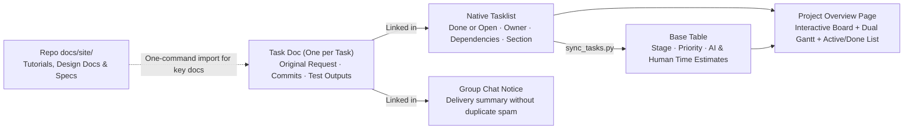

# Process Management

Large projects with coding agents usually get messy in two ways: the repo fills up with stale `TODO.md` and `PLAN_v2.md` files nobody trusts, and agents mark tasks "Done" the moment code compiles—long before real testing happens. `soar-devflow-tasks` keeps progress honest and organized.

## Where Everything Lives {#truth-sources}

Instead of scattering temporary progress files across the codebase, each type of information has one clear home:



| Content | Where It Lives | Why |
| --- | --- | --- |
| Whether a task is done, owner, start/due dates, dependencies | Native Feishu/Lark Tasklist | Clear single status; nobody fakes completion by editing a spreadsheet cell |
| User's exact words, commit hashes, test logs, remaining checks | One dedicated Task Doc per task | Click one link to see the full context without digging through chat history |
| Project stage, priority, estimated AI hours, estimated human hours | Base Table | Powers Kanban grouping, Gantt views, and filtering |
| Small bug fixes, copy tweaks, minor parameter tuning | Rolling `<PREFIX>-00` minor-fix doc | Keeps ten-minute fixes from spawning dozens of tiny tickets |
| Tutorials, internal design explanations, API specs | Repo `docs/site/` (VitePress) | Versioned alongside code, free of sprint chatter |

## How a Task Runs Day to Day {#daily-loop}

1. **Register before coding**: Before starting any substantive feature, optimization, cross-module refactor, or bugfix, read the target repo's `.soar-devflow/tasks.json` (in multi-repo workspaces, run inside the target sub-repo or pass `--config`). For standalone deliverables not already tracked remotely, preview with `create_task.py --dry-run` and create the native task, dedicated Wiki doc, and overview mount in one step:
   ```bash
   python3 .agents/skills/soar-devflow-tasks/scripts/create_task.py \
     --title "<Task Title>" --section "<Domain Section>" --due YYYY-MM-DD --dry-run
   ```
   Small bug fixes and copy tweaks go into the rolling `<PREFIX>-00` minor-fix doc instead; pure Q&A never spawns tasks.
2. **Code and record evidence**: Update the task doc at kickoff and delivery (not on every tool call). Prefix commit messages with the task ID (such as `NOV-03: ...`) and leave one structured commit line in the task doc so future sessions can trace changes easily:
   ```text
   Commit: <repo> <branch> <from>..<to> (merged <merge-sha>; version <ver>)
   ```
3. **Sync at the end of a batch**: After creating, closing, rescheduling, or linking tasks, run:
   ```bash
   python3 .agents/skills/soar-devflow-tasks/scripts/sync_tasks.py
   ```
   The script updates mirrored columns in Base, refreshes the interactive Kanban + Gantt widget at the top of the overview doc, and moves task blocks into the "Active" or "Completed" section (folding completed categories so the page stays tidy).

## Separate AI Coding Time from Human Review Time {#dual-timeline}

Coding and verification move at completely different speeds when working with agents: an agent might implement a module and unit tests in 90 minutes, while human design review, hardware bench access, or cross-team testing takes three days.

SOAR DevFlow tracks two timelines side by side:
- **AI Coding Window**: Uses `AI开发估算小时` (*AI Est. Hours*), `AI计划开始`, and `AI计划交付` to map out agent implementation order and workload;
- **Delivery / Review Window**: Uses native task start/due dates plus `人工验收估算小时` (*Human Review Hours*) and wait notes to track real milestones;
- **Real dependencies only**: Only add a native `prev` dependency when task B literally cannot be built without artifact A. Review queues and ordering preferences go in notes so unrelated work is never artificially blocked.

## What Counts as "Done"? {#acceptance}

This is the single most important rule for keeping agent progress trustworthy:

- **Tasks fully verifiable by automated checks**: Only when unit tests, integration tests, and build checks actually run and pass does the agent mark the native task complete (`task +complete`).
- **Tasks needing human judgment or hardware**: Whenever architecture trade-offs, UI feel, or physical hardware tests are involved, **the native task stays open**, Base status is set to `待人工验收` (*Pending Human Review*), and the task doc lists what passed automatically, what has not run, and what needs human sign-off.
- **Planning is not approval to build; closing a task is not approval to deploy**: Organizing tasks records a plan, and production rollouts still follow your repo's release approval rules.

## Group Chat Delivery Notices (Without Spam) {#notifications}

Instead of noisy background polling scripts, the agent working on a task runs `notify_delivery.py` once after writing evidence and syncing:

```bash
python3 .agents/skills/soar-devflow-tasks/scripts/notify_delivery.py \
  --delivery /tmp/delivery.json --dry-run
python3 .agents/skills/soar-devflow-tasks/scripts/notify_delivery.py \
  --delivery /tmp/delivery.json
```

Before sending, the script checks that:
- The task belongs to your project tasklist and the doc URL matches the link on the native task;
- A `"completed"` notice is allowed only if the native task is actually closed, and `"review"` / `"partial"` notices require the native task to still be open;
- Each `(task_guid, delivery_id)` is recorded locally before sending, so network retries never post duplicate messages to the group—and changing the summary requires a new `delivery_id`.

## Further Reading

- Try the interactive board and dual-timeline Gantt in your browser: [Live Kanban & Gantt Demo](./live-demo.md#playground)
- Full CLI flags for sync and notification scripts: [CLI Scripts Reference](../reference/cli-scripts.md#task-scripts)
