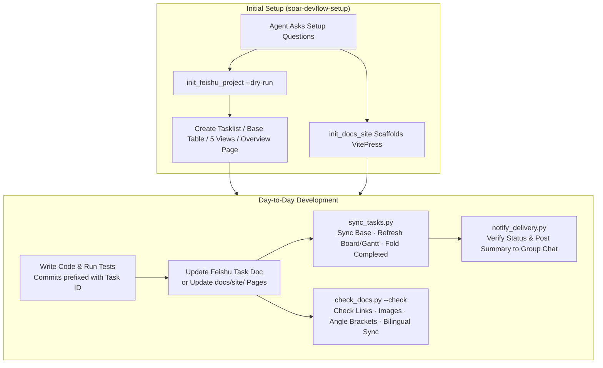

# Workflow & Design Internals

## Goals & Non-Goals {#overview}

SOAR DevFlow is built to keep large agent-assisted projects orderly without deploying an extra server or adopting heavy enterprise software. It combines **three standard Agent Skills** with **dependency-free Python and Node scripts** so coding agents track progress accurately, respect human review boundaries, and maintain clean documentation.


- **What it handles**: One-way sync from native Feishu/Lark tasks to Base tables, embedded HTML5 Kanban + dual-timeline Gantt views, group chat delivery summaries, VitePress docs site scaffolding, tutorial/reference templates, automated browser screenshots with numbered callouts, and pre-commit doc checks.
- **What it intentionally avoids**: Background polling daemons, storing credentials in Git, or replacing human sign-off on UX and hardware testing.

## Where Files Are Stored {#config-separation}

So one installation works cleanly across multiple repositories, files are kept in three places according to their role:

| What | Where It Lives | Committed to Your Git Repo? |
| --- | --- | --- |
| **Reusable skills & scripts** (`soar-devflow`) | `.agents/skills/` or `~/.agents/skills/` | Optional (workspace copy or global install) |
| **Your project's config** (Feishu board IDs, stages, docs folder) | `.soar-devflow/` in your project repo | **Yes** (shared by teammates & agents) |
| **Login tokens & sent-message log** | `lark-cli` local store & `~/.local/state/soar-devflow/` | **Never** |

## How the Scripts Fit Together {#dataflow}



## Safeguards Against Data Loss & Bad Writes {#safety}

Scripts that touch shared team docs and tables must be conservative:

1. **Native tasks own completion state**: `sync_tasks.py` mirrors title, assignee, dates, dependencies, and completion from native tasks into Base while leaving manual Base columns (priority, stage, hour estimates, notes) untouched. Rows removed from a tasklist are never deleted automatically.
2. **Stop on stalled pagination**: If task, section, or Base pagination returns a repeated or empty token, sync aborts immediately instead of writing a truncated snapshot.
3. **Two-step linking for new rows**: Newly inserted Base rows return `next_run_updates_links: true` first so record-link columns (`前置任务`, `父任务`) are populated only after Base finishes indexing.
4. **Backup before moving doc sections**: `reconcile_sections.py` saves a local JSON backup of the overview doc before moving completed task blocks, then re-reads the document to verify zero lost tasks or links.
5. **No fake or duplicate chat notices**: `notify_delivery.py` refuses `"completed"` notices while the native task is open, records a unique UUID on disk before sending so retries never double-post, and pauses for manual check if a send stays ambiguous for over 50 minutes.

## Code Layout & Running Tests {#verification}

All Python scripts use only the Python 3.10+ standard library:

- `skills/soar-devflow-setup/scripts/`: Skill installer, Feishu project creator, and VitePress site generator;
- `skills/soar-devflow-tasks/scripts/`: Task sync, HTML5 board/Gantt renderer, overview section mover, chat notifier, and Markdown-to-Feishu XML converter;
- `skills/soar-devflow-docs/scripts/`: Docs checker, local read-only proxy, and Playwright screenshot tool;
- `scripts/privacy_scan.py`: Scans text files for accidental private URLs, home paths, or tokens before publishing.

Run the test suite locally:

```bash
python3 -m unittest discover -s tests -v
python3 scripts/privacy_scan.py
python3 skills/soar-devflow-docs/scripts/check_docs.py --config site/docs.config.json --check
```

To set up SOAR DevFlow in your own repository, start with [Quickstart](../guide/quickstart.md#agent-setup).
