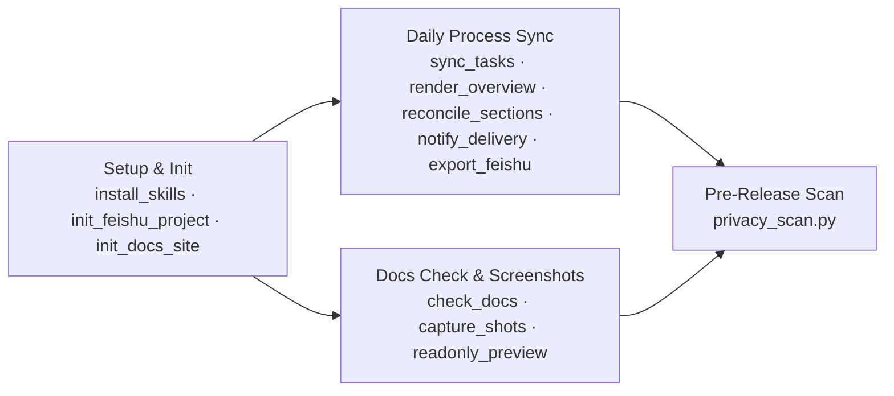

# CLI Scripts Reference

All Python scripts run on the standard library in Python 3.10+ (zero `pip` packages needed) and print JSON output so both humans and coding agents can read results cleanly. Web screenshot capture runs on Node.js and imports Playwright only when taking screenshots.

## Setup & Initialization Scripts {#setup-scripts}

- **`skills/soar-devflow-setup/scripts/install_skills.py`**
  Copies or symlinks the 3 skills into `.agents/skills/` (plus `.claude/skills/` symlinks) or `~/.agents/skills/`.
  - Common flags: `--target PATH`, `--scope workspace|global`, `--mode copy|symlink`, `--no-claude-link`
- **`skills/soar-devflow-setup/scripts/init_feishu_project.py`**
  Creates a Feishu/Lark tasklist, domain sections, Base table, 5 Kanban/Gantt views, overview doc, and `<PREFIX>-00` minor-fix rolling task, then writes `.soar-devflow/` config files.
  - `--spec PATH`: Load setup parameters from JSON
  - `--dry-run`: **Print planned remote resources without creating anything**
  - `--skip-initial-sync`: Skip running the first sync immediately after creation
- **`skills/soar-devflow-setup/scripts/init_docs_site.py`**
  Generates a VitePress docs site pre-configured with local search, Mermaid, math, and image zoom, plus `.soar-devflow/docs.json`.
  - Common flags: `--target PATH`, `--title TEXT`, `--languages zh|zh,en`, `--base /docs/`, `--site-dir docs/site`

## Process Management Scripts {#task-scripts}

- **`skills/soar-devflow-tasks/scripts/sync_tasks.py`**
  Syncs native tasks into Base, refreshes the HTML5 board/Gantt widget on the overview page, and moves completed task blocks. Uses a file lock so concurrent runs never create duplicate rows.
  - `--config PATH`: Path to `tasks.json` (auto-discovered if omitted)
  - `--dry-run`: Read remote state and compute diff without writing
  - `--allow-create-overview`: Insert the HTML5 overview block if not yet present
  - `--seed-process-fields`: Fill empty Base process columns from initial seeds without overwriting manual edits
- **`skills/soar-devflow-tasks/scripts/render_overview.py`**
  Called automatically by `sync_tasks.py`, or run directly to render a standalone HTML board from JSON:
  - `--data fixture.json --output overview.html`
- **`skills/soar-devflow-tasks/scripts/reconcile_sections.py`**
  Called by `sync_tasks.py` to move native task blocks between Active and Completed sections on the overview doc, saving a local backup before changes and verifying readback afterward.
- **`skills/soar-devflow-tasks/scripts/notify_delivery.py`**
  Sends a delivery summary to Feishu/Lark group chat; requires `--delivery` and never polls in the background.
  - Common flags: `--config PATH`, `--delivery FILE|-`, `--dry-run`
- **`skills/soar-devflow-tasks/scripts/export_feishu.py`**
  Converts Markdown to Feishu DocxXML (turning Mermaid code blocks into native Feishu whiteboards):
  - `python3 export_feishu.py source.md --output out.xml`

## Docs & Screenshot Scripts {#docs-scripts}

- **`skills/soar-devflow-docs/scripts/check_docs.py`**
  Checks for broken links, missing images, unclosed angle brackets, bilingual anchor mismatches, and short stub pages:
  - `--config PATH`, `--check` (validate only), `--build` (validate then run `npm run build`)
- **`skills/soar-devflow-docs/scripts/capture_shots.mjs`**
  Opens pages in headless Chromium via Playwright to take screenshots with numbered callout boxes from `shots/*.json`:
  - `--config PATH`, `--upstream URL`, `--only id1,id2`, `--list`, `--hook ./custom-hook.mjs`
- **`skills/soar-devflow-docs/scripts/readonly_preview.mjs`**
  Local read-only HTTP proxy used by `capture_shots.mjs` to block non-`GET`/`HEAD` requests against live apps.

## Privacy Check Script {#privacy-scan}

- **`scripts/privacy_scan.py`**
  Scans repository files before open-source release to catch Tailscale addresses, real home paths, private Feishu tenant domains, user/chat IDs, or secret tokens.
  - Common flags: `--root PATH`, `--include-untracked`, `--allow GLOB`, `--json`

## Related Guides

- See [Process Management](../guide/task-workflow.md#daily-loop) for daily task syncs and [Docs Site & Tutorials](../guide/docs-craft.md#gates) for writing and screenshot workflows.
