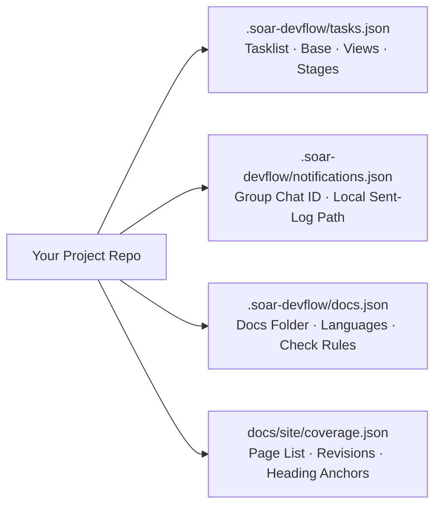

# Configuration Reference

All scripts automatically walk up from your current working directory to find `.soar-devflow/` (and also support legacy `docs/development_management/` paths). None of these files store passwords or tokens, so commit them directly to Git.



## `.soar-devflow/tasks.json` {#tasks-json}

Generated automatically by `init_feishu_project.py`. See `skills/soar-devflow-tasks/assets/tasks.config.example.json` for a full example.

| Field | Type | Required | Purpose |
| --- | --- | --- | --- |
| `project` | string | Yes | Project name shown on the overview board header |
| `task_prefix` | string | Yes | Task ID prefix (e.g. `NOV`, `CORE`) used in commits and rolling `<PREFIX>-00` |
| `profile` | string | No | `lark-cli` profile name; leave blank to use your default logged-in profile |
| `timezone` / `timezone_offset_hours` | string / number | No | Timezone for Gantt "today" marker and sync timestamps (`Asia/Shanghai` / `8`) |
| `tasklist_guid` / `tasklist_url` | string | Yes | Native Feishu/Lark tasklist ID and URL |
| `base_token` / `base_url` / `table_id` | string | Yes | Base app token, URL, and table ID |
| `kanban_view_id` / `stage_view_id` / `priority_view_id` / `gantt_view_id` / `ai_view_id` | string | No | Base view IDs used for "Open full board/Gantt" links |
| `document_id` / `document_url` | string | No | Project overview document ID and URL |
| `minor_fixes_task_id` / `minor_fixes_guid` / `minor_fixes_url` | string | No | Standing minor-fix rolling task ID, GUID, and doc URL |
| `stages` | string[] | No | Ordered stage names controlling Kanban column order and colors |
| `document_visualization` | object | No | Title, marker ID, and default grouping for the embedded HTML5 overview |
| `document_task_sections` | object | No | Heading names (`待办` / `已完成`) and folding options on the overview doc |
| `allow_multiple_assignees` | boolean | No | Default `false`; alerts you if a task has multiple assignees |

## `.soar-devflow/notifications.json` {#notifications-json}

Configures group chat delivery notifications:

| Field | Type | Required | Purpose |
| --- | --- | --- | --- |
| `mode` | string | Yes | Set to `"agent"` (sent explicitly by the agent, never via background polling) |
| `chat_id` | string | Yes | Target Feishu/Lark group chat ID (`oc_...`; invite your bot to the group first) |
| `tasklist_guid` | string | Yes | Only tasks belonging to this tasklist (or its subtasks) may send notices |
| `profile` | string | No | `lark-cli` profile name |
| `state_path` | string | No | Local path tracking sent notices (`~/.local/state/soar-devflow/`, never in Git) |
| `send_as` | string | No | Sender identity, defaults to `"bot"` |
| `allowed_doc_hosts` | string[] | No | Allowed task doc domains (`feishu.cn`, `larkoffice.com`, `larksuite.com`) |
| `footer_note` | string | No | Custom note appended at the bottom of group messages |

## `.soar-devflow/docs.json` {#docs-json}

Generated by `init_docs_site.py` to configure docs checks and automated screenshots:

| Field | Type | Required | Purpose |
| --- | --- | --- | --- |
| `site_dir` | string | Yes | VitePress docs folder relative to repo root (e.g. `docs/site`) |
| `languages` | string[] | Yes | Enabled languages, e.g. `["zh"]` or `["zh", "en"]` |
| `root_language` | string | No | Set when the default language lives directly in `site_dir/` instead of `site_dir/<lang>/` |
| `coverage_file` | string | No | Page manifest filename inside `site_dir` (default `coverage.json`) |
| `single_source` | object | No | Allowed outside-site Markdown folders and README paragraph duplication check |
| `quality` | object | No | Minimum character thresholds (`min_chars`) and visual requirements for guides/references |
| `help_map_file` | string | No | Optional mapping file from UI `?` help buttons to `page#anchor` targets |
| `shots` | object | No | Manifest folder, output folder, and local dev server URL for automated screenshots |

## `coverage.json` Page Manifest {#coverage-json}

Lists managed pages inside `site_dir`, their sidebar section, localized titles, revision counter, and required heading anchors:

```json
{
  "guide/quickstart": {
    "section": "guide",
    "title_zh": "快速上手",
    "title_en": "Quickstart",
    "translation_revision": 1,
    "anchors": ["agent-setup", "manual-setup", "verification"]
  }
}
```

## Related Pages

- How setup scripts create these files automatically: [Quickstart](../guide/quickstart.md#manual-setup)
- CLI flags for each script: [CLI Scripts Reference](./cli-scripts.md#setup-scripts)
