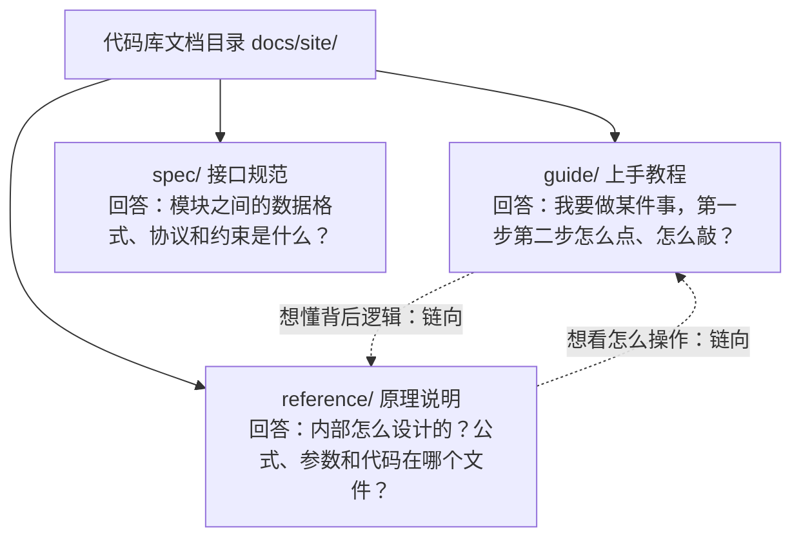

# 文档站与教程编写

很多项目让 AI 写文档，写出来一大堆正确的废话：想照着上手的人找不到第一步点哪里，想查原理的人找不到代码在哪个文件，过两周界面改了截图全对不上。`soar-devflow-docs` 给 Agent 定了一套实在的写作规矩，并配齐了自动截图和检查脚本。

## 把三类文档分开写 {#taxonomy}

所有技术文档集中放在代码库的 `docs/site/`（基于 VitePress），按读者到底想干嘛分成三类，不混在一锅粥里：



| 类别 | 给谁看 | 怎么写才好用 |
| --- | --- | --- |
| **上手教程 `guide/`** | 第一次用的人、操作员、新进组同学 | 按任务一步步编号写；每一步都写清楚输入什么、**正常应该看到什么结果**，配上标好序号的界面截图 |
| **原理说明 `reference/`** | 要改代码、查 bug、审算法逻辑的人 | 先说做什么和不做什么，再摆公式、流程图（Mermaid）、参数表、具体源码文件路径，以及怎么自己跑测试验证 |
| **接口规范 `spec/`** | 跨模块或跨团队对接的人 | 把字段类型、状态流转、报错约定写准确，给小标题加上固定 `{#id}` 锚点方便别处直接链接 |

## 现成的写作模板与核对习惯 {#templates}

在 `skills/soar-devflow-docs/references/` 里放好了两份直接能照着填的模板：

- **教程页 7 段结构**：一句话说明白本页干嘛 → 你将学会哪几件事 → 开始前准备什么 → 界面速览（带标号截图 + 标号对照表）→ 分步操作（带预期结果）→ 进阶用法 → 常见报错排查表 → 相关原理链接。
- **说明页 8 段结构**：设计目标与边界 → 模型与公式 → 数据流/状态机图 → 关键参数表（注明来自哪个配置文件）→ 核心代码路径列表 → 怎么复现验证 → 已知局限与容易误解的地方 → 核查发现（写文档时如果发现旧说法和当前代码不一致，直接如实写出来）。

写文档时要求 Agent 守住三条底线：
1. **对着当前源码写**：参数默认值、命令行开关、文件路径必须去代码里看一眼再写，不凭印象瞎编；
2. **做到哪说到哪**：还没做完或没测过的功能直接写明限制，不把“刚把接口接上”吹成“已经完整验证”；
3. **别把过程流水账搬进来**：哪天开会改了需求记在飞书任务文档里，技术文档只写当前版本是怎么工作的。

## 自动网页截图与编号标注 {#screenshots}

手工截图最烦的是界面稍微改一点就得重截几十张图。`capture_shots.mjs` 支持把截图要求写进 JSON 配置文件，用 Playwright 自动打开浏览器截图并画上醒目的高亮框和 ①②③ 编号：

1. 在 `docs/site/shots/<页面>.json` 里写清楚要拍哪个路径、窗口多大、用深色还是浅色主题、要框出哪几个元素：
   ```json
   [
     {
       "id": "dashboard-overview",
       "page": "/dashboard",
       "viewport": [1440, 900],
       "theme": "dark",
       "annotate": [
         { "selector": "#run-btn", "label": "1" },
         { "selector": "#status-bar", "label": "2", "badge": "left" }
       ]
     }
   ]
   ```
2. 跑一条命令生成或更新图片（输出到 `public/shots/<id>.png`）：
   ```bash
   node .agents/skills/soar-devflow-docs/scripts/capture_shots.mjs \
     --upstream http://127.0.0.1:5173 --only dashboard-overview
   ```
3. **不怕误触正在跑的服务**：配套的本地代理只转发页面读取请求，自动拦住所有 `POST/PUT/DELETE` 写请求，所以对着正在跑的开发环境截图也不会误点按钮改坏后台状态。如果弹窗在 `<dialog>` 顶层，标号框也会自动挂到弹窗上层不会被挡住。

## 提交前跑一遍自动检查（`check_docs.py`） {#gates}

光靠嘴上叮嘱很容易漏，提交或发版前跑一次 `check_docs.py --check`，会自动帮你把常见坑全查一遍：

- **查未闭合的尖括号**：VitePress 会把 Markdown 当 Vue 模板编译，正文里不小心写出 `<stage>`、`<store>余量` 这种裸尖括号会直接把构建炸掉，脚本会提前精准报出来；
- **查断链和缺图**：站内相对链接指错了文件、锚点拼错了、或者图片没放进 `public/` 都会直接报错；
- **查中英文是否对齐**（开启双语时）：核对中英文两页是否都更新了版本号、小标题上的 `{#anchor}` 锚点是不是一一对应，禁止用 `@include` 偷懒凑数；
- **查空壳水文**：教程和说明页如果字数太少，或者连一张截图/流程图都没有，直接拦住不让过；
- **查到处乱放文档**：防止在文档站目录外又随手建一堆重复的技术 Markdown，或把外面的 `README.md` 整段原样粘进文档站。

## 延伸阅读

- 查看 `.soar-devflow/docs.json` 各项配置含义：[配置文件说明](../reference/config-schema.md#docs-json)
- 了解重要设计文档怎么一键导入飞书：[飞书过程管理](./task-workflow.md#truth-sources)
