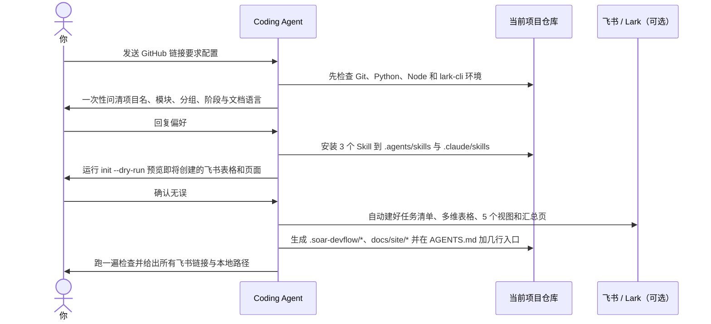

# 快速上手

在项目里接入 **SOAR DevFlow** 有两种方式：最省心的是把仓库链接发给你的 Coding Agent，让它问你几个问题自动配好；也可以自己敲四条命令手动装。飞书过程管理和 VitePress 文档站两个模块相互独立，可以一起开，也可以只开其中一个。

## 方式一：让 Coding Agent 对话式自动配置 {#agent-setup}

在你的项目目录里打开 **Claude Code、Codex、Antigravity 或 Cursor**，直接发送：

```text
请阅读 https://github.com/NJU-SOARLAB/soar-devflow 的 README（包含底部的 Agent 配置说明），
先问清楚我的项目设置偏好，然后在当前仓库帮我装好并验证 SOAR DevFlow。
```

Agent 读完 README 底部的安装说明后，会按下面这个流程走完配置：



在真正往你的飞书账号建表或建文档前，Agent 都会先用 `--dry-run` 把准备建哪些东西列给你看，确认之后才会实际创建；你仓库里原有的 `AGENTS.md` 规则也不会被覆盖。

## 方式二：命令行手动安装 {#manual-setup}

如果你想自己一步步跑，按下面四步执行即可：

1. **拉取仓库并安装 Skill**：
   ```bash
   git clone https://github.com/NJU-SOARLAB/soar-devflow.git ~/.cache/soar-devflow
   python3 ~/.cache/soar-devflow/skills/soar-devflow-setup/scripts/install_skills.py \
     --target /path/to/your-repo \
     --scope workspace \
     --mode copy
   ```
   - 想在本机所有项目共用，把 `--scope workspace` 改成 `--scope global`。
   - 执行后会在你的仓库下生成 `.agents/skills/soar-devflow-{setup,tasks,docs}`，并在 `.claude/skills/` 下建好软链接。

2. **初始化飞书过程管理（可选，先 `--dry-run` 看预览）**：
   先装好飞书官方 CLI（`npx @larksuite/cli@latest install`）并登录，然后运行：
   ```bash
   python3 .agents/skills/soar-devflow-setup/scripts/init_feishu_project.py \
     --project "Nova Stack" \
     --prefix NOV \
     --sections "架构与内核,核心算法,接口与工具,验证与发布" \
     --stages "阶段一·架构基线,阶段二·核心功能,阶段三·集成验收,日常·滚动维护" \
     --dry-run
   ```
   确认预览内容没问题后，去掉 `--dry-run` 再跑一次（如果想直接放进某个飞书知识库或配交付通知群，加上 `--space-id`、`--parent-node-token`、`--chat-id`）。脚本会在你的仓库生成 `.soar-devflow/tasks.json`、`task_documents.json` 和可选的 `notifications.json`。

3. **初始化 VitePress 文档站（可选，不依赖飞书）**：
   ```bash
   python3 .agents/skills/soar-devflow-setup/scripts/init_docs_site.py \
     --target /path/to/your-repo \
     --title "Nova Stack" \
     --languages zh,en \
     --base /docs/
   ```
   执行后会生成开箱即用的 `docs/site/`（配好了中文搜索、Mermaid 流程图、数学公式、图片点击放大和示例页面）以及 `.soar-devflow/docs.json`。

4. **在 `AGENTS.md` 加一段简短说明**：
   把 `~/.cache/soar-devflow/templates/AGENTS.snippet.md` 里的几行说明贴到你项目 `AGENTS.md` 末尾，之后新开的 Agent 会话就知道去 `.soar-devflow/` 读配置。

## 跑一遍验证 {#verification}

装好之后，在项目根目录跑两条检查确认一切正常：

```bash
# 1. 测试飞书连通性与配置（只读不改数据）
python3 .agents/skills/soar-devflow-tasks/scripts/sync_tasks.py --dry-run

# 2. 检查文档站格式并试跑一次构建
python3 .agents/skills/soar-devflow-docs/scripts/check_docs.py --check
cd docs/site && npm install && npm run build
```

## 常见问题处理 {#troubleshooting}

| 现象 | 原因 | 解决办法 |
| --- | --- | --- |
| `sync_tasks.py` 提示 `next_run_updates_links: true` | 飞书多维表格刚建完新行，后台索引需要几秒钟 | 正常现象，等几秒再跑一次 `sync_tasks.py` 就会把前置和父子关系补齐 |
| `lark-cli` 提示未登录 | 还没完成飞书账号授权，或 `--profile` 名字没对上 | 跑一遍 `lark-cli` 登录，核对 `.soar-devflow/tasks.json` 里的 `profile` |
| `check_docs.py` 报未闭合标签（如 `<stage>`） | VitePress 把正文当 Vue 模板编译，裸写的尖括号会被当成 HTML 标签 | 给占位符加上反引号写成 `` `<stage>` `` |
| `npm run build` 找不到命令 | 还没在 `docs/site/` 装前端依赖 | 进入 `docs/site/` 执行一次 `npm install` |

## 延伸阅读

- 日常怎么用飞书管任务、排期和发通知：[飞书过程管理](./task-workflow.md#truth-sources)
- 怎么写教程、自动网页截图与做文档检查：[文档站与教程编写](./docs-craft.md#taxonomy)
