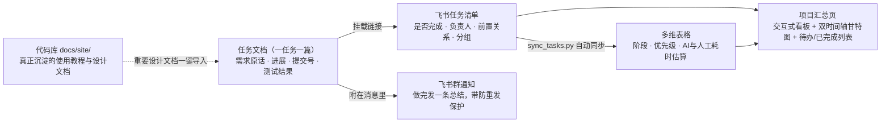

# 飞书过程管理

大项目最怕两件事：一是代码库里到处塞满临时的 `TODO.md`、`PLAN_v2.md`，过几天没人知道哪份算数；二是 Agent 刚把代码写完就急着把任务勾成“已完成”，把还没测过的半成品混进已完成列表。`soar-devflow-tasks` 用一套清楚的分工把日常开发进度管起来。

## 什么东西放在哪？ {#truth-sources}

不再为每个任务往代码库里塞本地进度文件，每样东西只在一个固定地方维护：



| 内容 | 放哪里 | 为什么要这样分 |
| --- | --- | --- |
| 任务完没完成、谁负责、起止日期、前置依赖 | 飞书原生任务清单 | 状态最直观，不靠手改表格单元格假装完成 |
| 用户当时的原话、改了哪些 commit、跑了什么测试、还差什么 | 每个任务唯一的一篇飞书文档 | 点开一个链接就能看全来龙去脉，不用翻聊天记录 |
| 项目阶段、优先级、AI 预计几小时、人工预计几小时 | 多维表格（Base） | 方便排看板、拉甘特图和按阶段筛选 |
| 顺手修个小 bug、改两句文案或调个参数 | 统一记在 `<前缀>-00` 滚动小修文档里 | 避免为了十分钟的小改动建几十个零碎任务 |
| 给用户和新人看的教程、系统原理、接口规范 | 代码库 `docs/site/`（VitePress） | 跟代码一起版本管理，不跟日常流水账混在一起 |

## 平时怎么跑一轮任务？ {#daily-loop}

1. **动工前先挂单**：凡开始新需求、性能优化、跨模块重构或缺陷修复，先读取目标仓库的 `.soar-devflow/tasks.json`（多子仓工作区须在目标子仓运行或传入 `--config`）。若是独立交付且远端无重复单，先用 `create_task.py --dry-run` 核对自动编号与领域分组，再正式建单并自动创建唯一任务文档、挂载到汇总页：
   ```bash
   python3 .agents/skills/soar-devflow-tasks/scripts/create_task.py \
     --title "<任务标题>" --section "<领域分组>" --due YYYY-MM-DD --dry-run
   ```
   若只是顺手修小 bug 或微调文案，直接在 `<前缀>-00` 滚动小修文档追加一行记录即可；纯问答不建单。
2. **开发与留痕**：通常在开工和做完时各更一次任务文档，中间除非卡住或者需求变了，不写啰嗦的工具调用流水账。提交代码时标题带上任务编号（比如 `NOV-03: ...`），交付时在任务文档留一行固定的提交记录，方便以后反查：
   ```text
   提交：<仓库> <分支> <起>..<止>（合入 <主干合并提交>；版本 <版本>）
   ```
3. **跑一次同步脚本**：新建任务、完成任务、改排期或调依赖后，在批次末尾跑一次：
   ```bash
   python3 .agents/skills/soar-devflow-tasks/scripts/sync_tasks.py
   ```
   脚本会自动把飞书任务的最新状态同步进多维表格，刷新项目汇总页顶部的交互式看板与甘特图，并把汇总页下方的原生任务块自动移到「待办」或「已完成」分组（已完成分组默认折叠，页面始终清爽）。

## 把「AI 写代码时间」和「人工验收时间」分开排 {#dual-timeline}

用 Agent 做开发时，写代码和做验收根本不在一个时间尺度上：AI 把功能写完加上单测可能只要 1.5 小时，但等你空出时间看效果、排实验室设备或做联调可能要跨两三天。

所以我们在多维表格和甘特图里把这两段时间拆开了：
- **AI 实施窗口**：填 `AI开发估算小时`、`AI计划开始`、`AI计划交付`，用来看 Agent 这边的工作量和先后顺序；
- **交付 / 验收窗口**：用飞书任务本身的 `计划开始` / `计划截止` 加上 `人工验收估算小时`、`验收与等待说明`，用来盯真正的评审与里程碑节点；
- **前置依赖只挂真依赖**：只有“A 没做出来，B 根本没法动手写”才连前置关系；单纯等人工审核或者先后偏好写在说明里就行，别把不相关的任务全堵死。

## 什么才算“已完成”？ {#acceptance}

这是管住 Agent 最关键的一条规矩：

- **能靠自动化测试完全判定的任务**：只有单测、集成测试和构建检查**真跑了且全过**，Agent 才能用任务 GUID 把飞书原生任务标为完成（`task +complete`）。
- **需要人看或上硬件验证的任务**：只要涉及方案取舍、界面好不好用、或者要上真机实测，**飞书原生任务必须保持未完成**，多维表格状态标成 `待人工验收`，并在任务文档里老老实实写清楚哪些自动测试过了、哪些还没跑、还差哪一步人工确认。
- **排计划不等于批准开干，关单也不等于批准上线**：整理任务清单只是记计划；任务验收通过后要不要发正式版或替换线上服务，仍然按项目的发布流程走。

## 做完主动发群通知（不怕重复刷屏） {#notifications}

不用容易半夜乱报的后台定时轮询。每做完一个可审阅的阶段结果或完整交付，由当前干活的 Agent 主动调一次通知脚本往飞书群发总结：

```bash
python3 .agents/skills/soar-devflow-tasks/scripts/notify_delivery.py \
  --delivery /tmp/delivery.json --dry-run
python3 .agents/skills/soar-devflow-tasks/scripts/notify_delivery.py \
  --delivery /tmp/delivery.json
```

脚本在发消息前会帮你把关：
- 核对任务确实属于当前项目，且文档链接跟飞书任务里挂的一致；
- 如果你填 `completed`，飞书原生任务必须真完成了；如果飞书任务还没关单，就只能发 `review`（待验收）或 `partial`（阶段交付），绝不允许嘴上报完成、单子却没关；
- 本机自动记录已发送的 `(task_guid, delivery_id)`，网抖重试不会往群里连发两条一样的消息；如果改了交付内容想重发，必须换一个新的 `delivery_id`。

## 延伸阅读

- 点开试玩实际的看板与双时间轴甘特图：[看板与甘特图在线演示](./live-demo.md#playground)
- 查看同步与通知脚本的完整参数：[脚本与命令行说明](../reference/cli-scripts.md#task-scripts)
