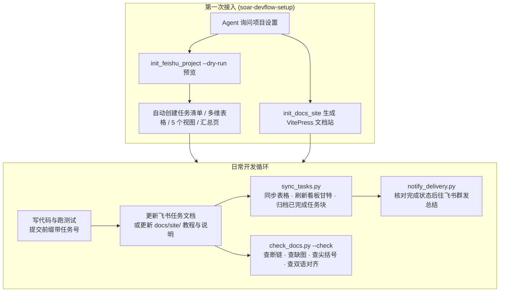

# 整体工作流与设计细节

## 这套工具解决什么问题、不做什么 {#overview}

SOAR DevFlow 的目标很单纯：在不让你多维护一台服务器、不多装一套重型项目管理软件的前提下，靠 **3 个标准 Agent Skills + 一组纯 Python/Node 小脚本**，让 Coding Agent 在大项目里乖乖按工程规矩办事——进度记清楚、验收不掺水、文档写扎实。


- **它管的事**：飞书任务与多维表格单向同步、汇总页交互式看板与双时间轴甘特图、做完自动发群通知、VitePress 文档站脚手架、教程与说明写作规范、自动网页截图打标号、以及提交前的文档质量检查。
- **它不管的事**：不自己跑常驻后台轮询服务，不在仓库里存任何账号密码，也不替人做主观体验或硬件实测的最终拍板。

## 配置与本地状态怎么存放 {#config-separation}

为了让同一套 Skill 装好后能在你们团队的所有仓库里直接复用，文件按用途分在三个地方：

| 放什么 | 存在哪里 | 要不要提交进 Git |
| --- | --- | --- |
| **通用工作流与脚本**（本开源项目） | `.agents/skills/` 或 `~/.agents/skills/` | 随项目需要选择（工作区或全局） |
| **当前项目自己的配置**（飞书表格 ID、阶段名、文档目录） | 你的业务仓库 `.soar-devflow/` 目录 | **提交进 Git**，团队成员与多个 Agent 共享 |
| **账号登录态与防重发记录** | `lark-cli` 本机凭据库与 `~/.local/state/soar-devflow/` | **绝不进 Git** |

## 脚本之间是怎么配合的 {#dataflow}



## 脚本里的防呆与防丢数据保护 {#safety}

跟远端文档和表格打交道最怕脚本抽风把人写的东西冲掉，所以脚本里做了几层硬保护：

1. **只以飞书原生任务定完成状态**：`sync_tasks.py` 单向把原生任务的标题、负责人、日期、前置依赖和完成状态同步进多维表格，但会完整保留你在表格里手填的优先级、阶段、工时估算和备注；移出清单的旧行也不会被自动删掉。
2. **分页卡死直接停**：拉取任务、分组或表格记录时如果分页 token 异常，脚本直接报错退出，绝不拿半截数据去覆盖远端。
3. **新增任务分两步连线**：刚往多维表格插入新任务时先返回 `next_run_updates_links: true`，等几秒表格后台索引生效后再连前置与父子关系，防止关联写丢。
4. **改汇总页分区前先留备份**：`reconcile_sections.py` 在把任务从「待办」移到「已完成」之前，会先把整篇文档存一份本地临时备份；移完立刻重读一遍，确认所有任务块和文档链接一个没少才算成功。
5. **群通知防误报、防重发**：飞书任务没关单就不允许发“已完成”通知；发消息前先把唯一 ID 落盘，就算网络超时重试也不会往群里连刷两条一样的消息；如果状态超过 50 分钟对不上，会自动停住让你先看一眼群消息。

## 代码位置与本地自测 {#verification}

本仓库全部 Python 脚本只用 Python 3.10+ 标准库，不装任何第三方 Python 包即可运行：

- `skills/soar-devflow-setup/scripts/`：安装 Skill、初始化飞书全套表与页面、生成文档站骨架；
- `skills/soar-devflow-tasks/scripts/`：任务同步、HTML5 看板/甘特生成、汇总页分区整理、群通知、Markdown 转飞书 XML；
- `skills/soar-devflow-docs/scripts/`：文档站检查、只读本地代理与自动网页截图标号；
- `scripts/privacy_scan.py`：开源发布前扫描是否误带了内网地址、个人路径或密钥。

在仓库根目录可以随时跑全套测试：

```bash
python3 -m unittest discover -s tests -v
python3 scripts/privacy_scan.py
python3 skills/soar-devflow-docs/scripts/check_docs.py --config site/docs.config.json --check
```

想在自己的项目里装一套试试，直接看 [快速上手](../guide/quickstart.md#agent-setup)。
