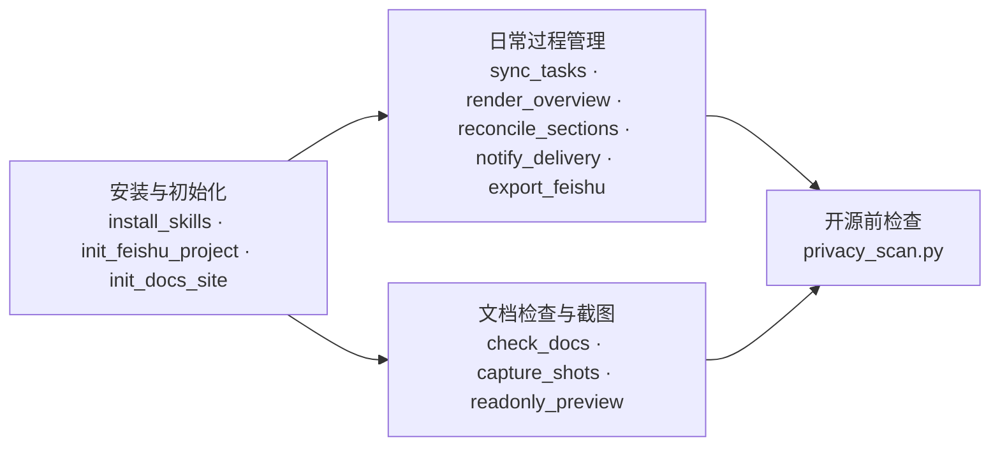

# 脚本与命令行说明

所有 Python 脚本都只依赖系统自带的 Python 3.10+ 标准库，不需要额外 `pip install`；输出结果统一是 JSON，方便人和 Agent 直接看结果。网页截图脚本使用 Node.js 运行，只在拍图时按需调用 Playwright。

## 安装与初始化脚本 {#setup-scripts}

- **`skills/soar-devflow-setup/scripts/install_skills.py`**
  把 3 个 Skill 装进目标仓库（`.agents/skills/` + `.claude/skills/` 软链）或本机全局目录（`~/.agents/skills/`）。
  - 常用参数：`--target PATH`、`--scope workspace|global`、`--mode copy|symlink`、`--no-claude-link`
- **`skills/soar-devflow-setup/scripts/init_feishu_project.py`**
  一键在飞书建好任务清单、领域分组、多维表格、5 个看板/甘特视图、汇总页骨架和 `<前缀>-00` 小修滚动任务，并在本地写出 `.soar-devflow/` 配置文件。
  - `--spec PATH`：从 JSON 文件读取初始化参数
  - `--dry-run`：**只打印将要创建的资源清单，不往飞书写入任何东西**
  - `--skip-initial-sync`：建完后暂不执行第一次同步
- **`skills/soar-devflow-setup/scripts/init_docs_site.py`**
  在目标仓库生成配好搜索、流程图、公式和图片放大的 VitePress 文档站骨架与 `.soar-devflow/docs.json`。
  - 常用参数：`--target PATH`、`--title TEXT`、`--languages zh|zh,en`、`--base /docs/`、`--site-dir docs/site`

## 过程管理脚本 {#task-scripts}

- **`skills/soar-devflow-tasks/scripts/sync_tasks.py`**
  把飞书原生任务同步到多维表格，同时更新汇总页顶部的 HTML5 看板/甘特图和下方的待办/已完成分区。自带文件锁，不怕多个终端同时跑产生重复行。
  - `--config PATH`：指定配置文件（不传则自动往上找 `.soar-devflow/tasks.json`）
  - `--dry-run`：只读远端数据并算差异，不改表格和文档
  - `--allow-create-overview`：汇总页里还没有看板块时允许首次插入
  - `--seed-process-fields`：仅对表格里还空着的字段填入初始预设值，不覆盖手改内容
- **`skills/soar-devflow-tasks/scripts/render_overview.py`**
  平时由 `sync_tasks.py` 自动调用；也可以单独拿来把一份 JSON 数据渲染成独立网页：
  - `--data fixture.json --output overview.html`
- **`skills/soar-devflow-tasks/scripts/reconcile_sections.py`**
  由 `sync_tasks.py` 自动调用，按飞书原生任务是否完成，把汇总页里的任务块和相邻文档链接移到「待办」或「已完成」下，改动前自动留本地备份并在改完后重读核对。
- **`skills/soar-devflow-tasks/scripts/notify_delivery.py`**
  做完一项交付后往飞书群发通知；必须传 `--delivery`，不会在后台自己扫描。
  - 常用参数：`--config PATH`、`--delivery FILE|-`、`--dry-run`
- **`skills/soar-devflow-tasks/scripts/export_feishu.py`**
  把 Markdown 转成飞书文档 XML（里面的 Mermaid 代码块会自动变成飞书原生画板）：
  - `python3 export_feishu.py source.md --output out.xml`

## 文档站与自动截图脚本 {#docs-scripts}

- **`skills/soar-devflow-docs/scripts/check_docs.py`**
  提交或构建前检查文档站是否有断链、缺图、未闭合尖括号、中英文锚点不一致或字数过少：
  - `--config PATH`、`--check`（只检查不跑构建）、`--build`（检查通过后顺便执行 `npm run build`）
- **`skills/soar-devflow-docs/scripts/capture_shots.mjs`**
  按 `shots/*.json` 配置自动打开浏览器截图并画上编号框：
  - `--config PATH`、`--upstream URL`、`--only id1,id2`、`--list`、`--hook ./custom-hook.mjs`
- **`skills/soar-devflow-docs/scripts/readonly_preview.mjs`**
  供 `capture_shots.mjs` 调用的本地只读代理，自动拦截非 `GET`/`HEAD` 写请求，保护正在运行的服务。

## 隐私检查脚本 {#privacy-scan}

- **`scripts/privacy_scan.py`**
  在公开仓库或发版前扫一遍全库文本文件，检查有没有误留内网 Tailscale 地址、本机个人目录路径、具体飞书租户链接、群号/用户 ID 或密钥 Token。
  - 常用参数：`--root PATH`、`--include-untracked`、`--allow GLOB`、`--json`

## 相关指南

- 日常任务同步与验收流程见 [飞书过程管理](../guide/task-workflow.md#daily-loop)，文档写作与截图见 [文档站与教程编写](../guide/docs-craft.md#gates)。
