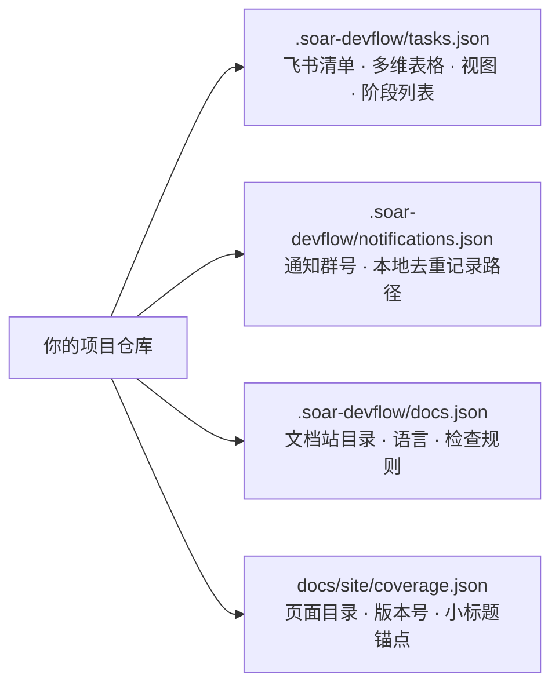

# 配置文件说明

装好 Skill 后，所有脚本都会从当前工作目录往上找 `.soar-devflow/` 文件夹（也兼容旧项目的 `docs/development_management/` 目录），读取你当前项目的配置。这些文件都不包含密码或 Token，直接随代码提交到 Git 即可。



## `.soar-devflow/tasks.json` {#tasks-json}

运行 `init_feishu_project.py` 会自动生成这份文件；完整示例见 `skills/soar-devflow-tasks/assets/tasks.config.example.json`。

| 字段 | 类型 | 必填 | 作用 |
| --- | --- | --- | --- |
| `project` | string | 是 | 项目名称，显示在汇总页看板标题上 |
| `task_prefix` | string | 是 | 任务编号前缀（如 `NOV`、`CORE`），用于提交记录和 `<前缀>-00` 滚动小修任务 |
| `profile` | string | 否 | `lark-cli` 的 profile 名字；留空就用默认登录账号 |
| `timezone` / `timezone_offset_hours` | string / number | 否 | 时区设置，默认 `Asia/Shanghai` 与 `8` |
| `tasklist_guid` / `tasklist_url` | string | 是 | 飞书原生任务清单 ID 与打开链接 |
| `base_token` / `base_url` / `table_id` | string | 是 | 飞书多维表格 ID、链接与数据表 ID |
| `kanban_view_id` / `stage_view_id` / `priority_view_id` / `gantt_view_id` / `ai_view_id` | string | 否 | 多维表格里各个看板与甘特视图的 ID，用来生成跳转按钮 |
| `document_id` / `document_url` | string | 否 | 项目汇总页文档 ID 与链接 |
| `minor_fixes_task_id` / `minor_fixes_guid` / `minor_fixes_url` | string | 否 | 日常小修滚动记录的任务编号、GUID 与文档链接 |
| `stages` | string[] | 否 | 项目阶段顺序列表，决定看板列的排列顺序与默认颜色 |
| `document_visualization` | object | 否 | 汇总页嵌入式 HTML5 看板的标题、标识与默认分组方式 |
| `document_task_sections` | object | 否 | 汇总页下方 `待办` / `已完成` 分区标题与折叠设置 |
| `allow_multiple_assignees` | boolean | 否 | 默认 `false`；如果一个任务设了多个负责人会提示你先确认表结构 |

## `.soar-devflow/notifications.json` {#notifications-json}

配置交付完成后的飞书群通知：

| 字段 | 类型 | 必填 | 作用 |
| --- | --- | --- | --- |
| `mode` | string | 是 | 固定填 `"agent"`（由当前 Agent 做完主动发，不用后台轮询） |
| `chat_id` | string | 是 | 接收通知的飞书/Lark 群号（以 `oc_` 开头，需先把机器人拉进群） |
| `tasklist_guid` | string | 是 | 只允许发送属于这个任务清单（及其子任务）的通知 |
| `profile` | string | 否 | `lark-cli` profile 名字 |
| `state_path` | string | 否 | 本机保存已发送记录的路径（默认放在 `~/.local/state/soar-devflow/` 下，不进 Git） |
| `send_as` | string | 否 | 发送身份，默认 `"bot"` |
| `allowed_doc_hosts` | string[] | 否 | 允许的任务文档域名后缀，默认支持 `feishu.cn`、`larkoffice.com`、`larksuite.com` |
| `footer_note` | string | 否 | 群消息末尾附带的提示语，可按团队习惯自己改 |

## `.soar-devflow/docs.json` {#docs-json}

运行 `init_docs_site.py` 会自动生成这份文件，用来告诉文档检查和截图脚本怎么工作：

| 字段 | 类型 | 必填 | 作用 |
| --- | --- | --- | --- |
| `site_dir` | string | 是 | VitePress 文档源目录（如 `docs/site`） |
| `languages` | string[] | 是 | 语言列表，比如单中文填 `["zh"]`，中英双语填 `["zh", "en"]` |
| `root_language` | string | 否 | 如果默认语言直接放在 `site_dir/` 根目录（而不是 `site_dir/zh/`），填 `"zh"` |
| `coverage_file` | string | 否 | 页面登记表文件名，默认 `coverage.json` |
| `single_source` | object | 否 | 控制哪些目录允许放过程或说明 Markdown，以及是否检查与外部 `README.md` 整段重复 |
| `quality` | object | 否 | 设置教程与说明页的最少字数要求（`min_chars`）以及是否必须配图 |
| `help_map_file` | string | 否 | 可选：界面上的帮助按钮 `?` 到文档章节锚点的映射表路径 |
| `shots` | object | 否 | 自动网页截图的清单目录、输出目录和前端本地预览地址 |

## `coverage.json` 页面登记表 {#coverage-json}

放在文档站目录里，登记每一篇正式文档属于哪个栏目、中英文标题叫什么、当前是第几版、以及哪些小标题锚点不能随便删改：

```json
{
  "guide/quickstart": {
    "section": "guide",
    "title_zh": "快速上手",
    "title_en": "Quickstart",
    "translation_revision": 1,
    "anchors": ["agent-setup", "manual-setup", "verification"]
  }
}
```

## 相关说明

- 怎么用脚本自动生成这些配置文件：[快速上手](../guide/quickstart.md#manual-setup)
- 每个脚本的具体命令行参数：[脚本与命令行说明](./cli-scripts.md#setup-scripts)
